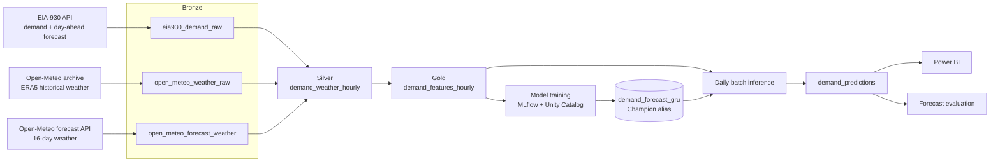

# Texas Electricity Demand Forecasting

Day-ahead hourly electricity demand forecasting for ERCOT, built as a medallion lakehouse on Databricks. The pipeline ingests EIA-930 demand and Open-Meteo weather into Delta tables governed by Unity Catalog, engineers leakage-safe features, compares gradient-boosted and deep learning models against EIA's own day-ahead forecast, and runs daily scheduled jobs for data refresh, batch inference, and forecast monitoring.

## Architecture



| Layer | Table | Contents |
|---|---|---|
| Bronze | `eia930_demand_raw` | Hourly ERCOT demand (`D`) and EIA day-ahead forecast (`DF`) since July 2015, raw UTC strings |
| Bronze | `open_meteo_weather_raw` | ERA5 hourly weather for Houston, Dallas, San Antonio, and Austin |
| Bronze | `open_meteo_forecast_weather` | 16-day forecast weather for the same cities, refreshed daily |
| Silver | `demand_weather_hourly` | Demand pivoted to wide format, load-weighted regional weather, gap-free UTC spine, quality flags |
| Gold | `demand_features_hourly` | Calendar, cyclical, weather, degree-day, lag, and rolling features with chronological split labels |
| Gold | `demand_predictions` | Daily 24-hour forecasts with model version and MLflow run ID |

## Design Decisions

**UTC as the time spine.** Silver builds one row per UTC hour across the overlap of demand and weather, so daylight saving transitions never create missing or duplicate hours. Local Central time is derived after the join and used only for calendar features. The silver notebook includes a check that both 1:00 AM hours on a fall-back night survive as distinct rows.

**Leakage control for a 24-hour horizon.** Every demand-derived feature uses data from t−24 or earlier: lags of 24, 48, 72, 167, 168, and 169 hours, and rolling statistics whose windows end at t−24. Weather features may use the target hour because a weather forecast is available for it at prediction time. The training notebook asserts that no lag shorter than the horizon is present.

**Load-weighted weather.** Weather from four metros is combined into one regional series using weights that approximate each metro's share of ERCOT load (Houston, Dallas, San Antonio, Austin).

**Honest baseline.** EIA publishes its own day-ahead forecast for ERCOT. It is carried through every layer but excluded from model features, and every evaluation reports performance relative to it.

**Weather train/serve gap.** Models are trained on ERA5 reanalysis (observed weather) but serve on forecast weather. Backtests therefore represent a best case; the live gap between the two is measured by the monitoring job. A NOAA HRRR ingestion path for historical day-ahead weather forecasts is prototyped in the bronze notebook for future forecast-parity training.

## Modeling

Models are trained on hourly history from 2019 through August 2026 (about 67,000 hours). The training notebook evaluates models in three stages:

1. **Time-based cross-validation:** five expanding-window folds, each validated on a three-month quarter from Q1 2025 through Q1 2026.
2. **Forward validation:** two windows in August 2026, used for model selection.
3. **Untouched holdout:** September 1 to 13, 2026, scored once after all selection and tuning.

Metrics on each window are MAPE, MAE, RMSE, bias, MAPE on the top 10% of demand hours, and the share of hours where the model beats the EIA forecast.

| Family | Models |
|---|---|
| Gradient boosting | CatBoost, LightGBM, XGBoost (with randomized hyperparameter search for the best) |
| Deep learning (PyTorch) | LSTM, GRU, CNN, CNN-LSTM over 24-hour input sequences |
| Hybrid | Residual CatBoost that predicts the error of the EIA forecast |

Feature engineering adds 50+ features on top of the gold table, including temperature-by-hour interactions, temperature anomaly, demand trend and volatility, peak-hour and working-hour flags, and weather change features. Highly correlated features are removed before training.

The production model is a GRU (24-hour sequence, 64 hidden units) trained on all data through August 31, 2026. It does not depend on the EIA forecast as an input. It is logged as an MLflow pyfunc model with its scaler, feature list, and configuration, and registered in Unity Catalog under the `Champion` alias.

## Operations

| Job | Notebook | Schedule (UTC) | Purpose |
|---|---|---|---|
| Data refresh | `jobs/daily_data_refresh.py` | Daily 02:00 | Pull the last 7 days of EIA demand and weather observations; refresh the 16-day weather forecast |
| Batch inference | `jobs/daily_batch_inference.py` | Daily, after refresh | Load the `Champion` model, build features, score the next 24 hours, validate, and write idempotently to `demand_predictions` |
| Evaluation | `jobs/forecast_evaluation.py` | Daily 03:00 | Compare yesterday's forecasts in `demand_predictions` with actuals; log MAPE, MAE, RMSE, and worst hours to MLflow; status is WARNING above 2.5% MAPE and CRITICAL above 3.0% |

Inference rejects a batch if any prediction is missing, negative, outside 15,000 to 100,000 MW, duplicated, non-contiguous, or not exactly 24 hours.

## Repository Structure

```
├── notebooks/
│   ├── 01_bronze_ingestion.py    # EIA-930 and Open-Meteo backfill; HRRR prototype; forecast weather
│   ├── 02_silver.py              # Pivot, weather aggregation, UTC spine, validation
│   ├── 03_gold_features.py       # Leakage-safe features, split labels, EIA baseline
│   └── 04_model_training.py      # CV, model comparison, tuning, holdout, GRU registration
├── jobs/
│   ├── daily_data_refresh.py
│   ├── daily_batch_inference.py
│   └── forecast_evaluation.py
└── src/
    └── feature_engineering.py    # Pandas implementation of notebook-level features
```

Notebooks are Databricks source-format exports (`.py`); import them into a Databricks workspace to run.

## Setup

1. Register for a free EIA API key at [eia.gov/opendata](https://www.eia.gov/opendata/) and store it as a Databricks secret:
   ```bash
   databricks secrets create-scope forecasting
   databricks secrets put-secret forecasting eia_api_key
   ```
2. Import the repository into a Databricks workspace with Unity Catalog enabled. Tables are created under the `dev` catalog in `stlf_bronze`, `stlf_silver`, and `stlf_gold`.
3. Run `notebooks/01` through `04` in order for the initial backfill and model.
4. Create Databricks Jobs for the three notebooks in `jobs/` on the schedules above.

## Tech Stack

Databricks, PySpark, Delta Lake, Unity Catalog, MLflow, pandas, scikit-learn, CatBoost, LightGBM, XGBoost, PyTorch, Power BI

## Data Sources

- [EIA-930 Hourly Electric Grid Monitor](https://www.eia.gov/electricity/gridmonitor/) via the EIA v2 API
- [Open-Meteo Historical Weather API](https://open-meteo.com/en/docs/historical-weather-api) (ERA5) and [Forecast API](https://open-meteo.com/en/docs)
- [NOAA HRRR](https://registry.opendata.aws/noaa-hrrr-pds/) on AWS Open Data (prototype)

## Author

Parth Patel · [LinkedIn](https://www.linkedin.com/in/parth-patel-03800917a/)
